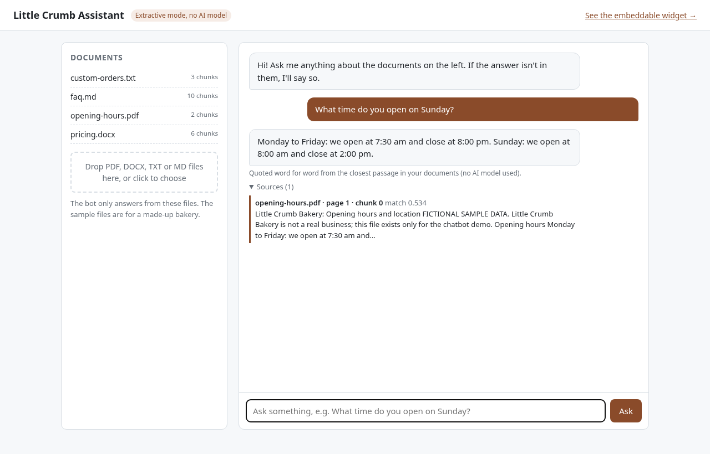
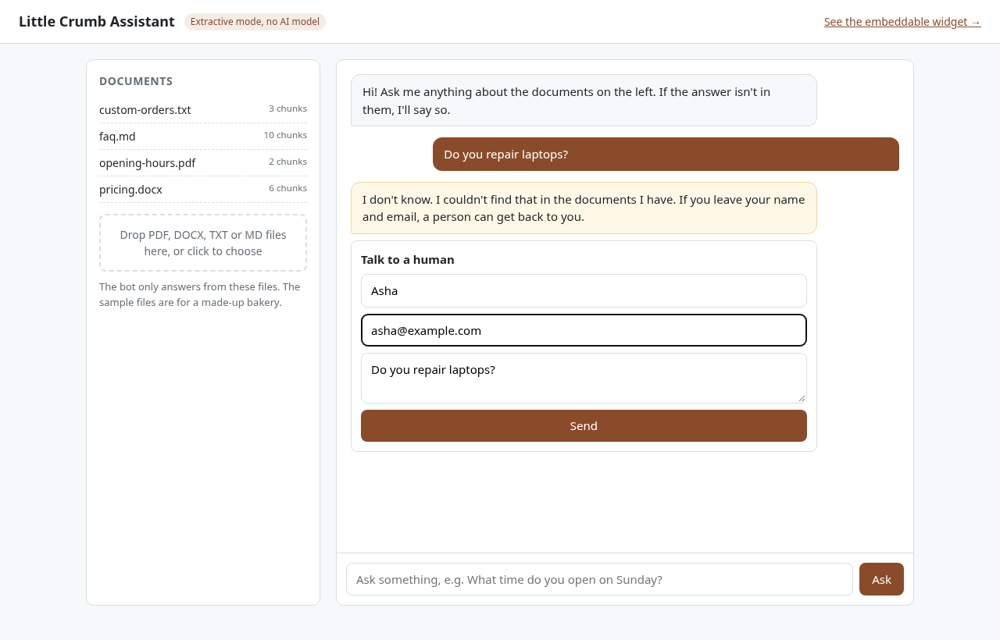
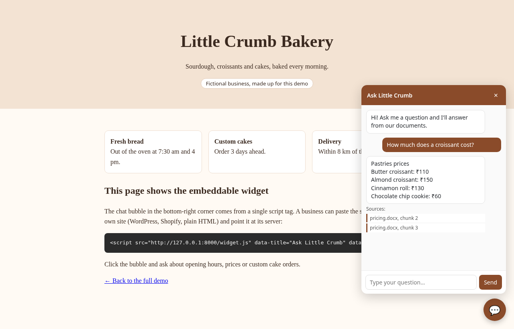
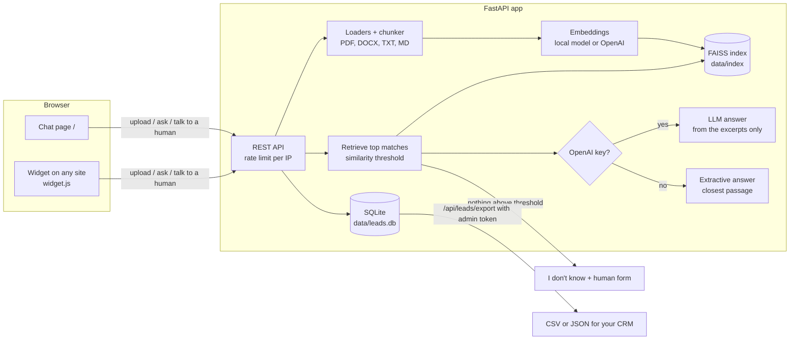

# docs-chatbot-demo

A small chatbot that answers questions from your own documents, and says "I don't know" when the answer isn't in them.

You upload PDFs, Word files, text or markdown. The app splits them into chunks, indexes them locally, and answers questions with a note of where each answer came from (file name, page for PDFs, and chunk number). It comes with a chat page, a one-line widget you can paste into any website, and a "talk to a human" form that saves the visitor's name, email and question so someone can follow up.

It ships with documents for **Little Crumb Bakery, a made-up bakery**, so it works as soon as you start it. None of the bakery's details are real.

It runs without any API key. With no key it answers by quoting the closest passage from your documents. Add an OpenAI key and it writes a short answer in its own words, still only from your documents.

## Screenshots

A question answered from the bakery's opening-hours PDF, with the source and page shown under the answer:



A question the documents can't answer. The bot says so and offers the "talk to a human" form:



The embeddable widget on a demo page for the bakery:



These were taken from the app running locally in extractive mode (no API key).

## How it works



1. **Upload.** Each file is read (PDFs page by page), split into chunks of about 500 characters, and a markdown or Word heading always starts a new chunk, so a FAQ with one heading per question becomes one chunk per question.
2. **Index.** Chunks are turned into vectors, by default with the small `all-MiniLM-L6-v2` model running on your own machine, and stored in a FAISS index in the `data/` folder. Nothing is sent to a hosted database.
3. **Ask.** The question is turned into a vector and compared with the chunks. Matches below `SIMILARITY_THRESHOLD` are thrown away. If nothing is left, the bot says "I don't know" and offers the human form. It never guesses.
4. **Answer.**
   - **Extractive mode** (no key): the answer is the closest passage, or the two sentences in it that best match the question, quoted word for word.
   - **LLM mode** (key set): the matching chunks go to the model with instructions to answer only from them, cite them, and reply "I don't know" otherwise. If the model can't be reached, the app falls back to the extractive answer instead of failing.

## Run it

### With Docker (one command)

```bash
git clone https://github.com/Guruprasath-Annadurai/docs-chatbot-demo.git
cd docs-chatbot-demo
cp .env.example .env        # optional, everything has a default
docker compose up --build
```

Open http://localhost:8000 for the chat page and http://localhost:8000/widget-demo for the widget. The first build downloads PyTorch (CPU) and the embedding model, so give it a few minutes. Your index and leads are kept in a Docker volume called `chatbot-data`.

### Without Docker

You need Python 3.11 or newer.

```bash
git clone https://github.com/Guruprasath-Annadurai/docs-chatbot-demo.git
cd docs-chatbot-demo
python -m venv .venv
source .venv/bin/activate              # Windows: .venv\Scripts\activate
pip install torch --index-url https://download.pytorch.org/whl/cpu   # optional: smaller CPU-only build
pip install -r requirements.txt
cp .env.example .env
uvicorn app.main:create_app --factory --port 8000
```

The first start downloads the embedding model (about 90 MB) and indexes the sample files.

### Run the tests

```bash
pip install -r requirements-dev.txt
pytest
```

The tests use the real local embedding model and extractive mode, so they don't need an API key or network access once the model is downloaded. LLM mode is tested with the OpenAI call replaced by a stub.

## Using it

**Ask questions** on the chat page. Every answer lists its sources with the match score and a short snippet.

**Upload documents** by dropping files onto the box on the left, or with curl:

```bash
curl -F "files=@menu.pdf" -F "files=@faq.md" http://localhost:8000/api/documents
```

Uploading a file with the same name replaces the old version.

**Add the widget to a website** by pasting this before `</body>`, with your server's address:

```html
<script src="https://chat.your-business.com/widget.js"
        data-title="Ask us" data-color="#8a4b2a"
        data-greeting="Hi! Ask me about our opening hours, prices or orders." defer></script>
```

Set `ALLOWED_ORIGINS` to your site's address (for example `https://your-business.com`) so only your site can call the API from a browser.

**Get the leads** from the "talk to a human" form. Set `ADMIN_TOKEN` in `.env`, then:

```bash
curl -H "X-Admin-Token: $ADMIN_TOKEN" "http://localhost:8000/api/leads/export?format=csv" > leads.csv
```

Leave out `format=csv` to get JSON. Most CRMs (HubSpot, Zoho, Pipedrive and so on) can import the CSV, or you can call the endpoint from a scheduled job.

### API

| Method | Path | What it does |
| --- | --- | --- |
| GET | `/api/health` | Mode, embedding model, number of documents and chunks |
| GET | `/api/documents` | List indexed files |
| POST | `/api/documents` | Upload one or more files (`files` form field) |
| DELETE | `/api/documents/{name}` | Remove a file from the index |
| POST | `/api/chat` | `{"question": "..."}` returns the answer, sources, and whether to offer a human |
| POST | `/api/leads` | `{"name", "email", "question", "page_url"}` saves a lead |
| GET | `/api/leads/export` | All leads as JSON or CSV, needs the admin token |

FastAPI's interactive docs are at http://localhost:8000/docs.

## Making it work for a business

1. **Swap the documents.** Delete the files in `sample_docs/` (or set `LOAD_SAMPLE_DOCS=false`) and upload the business's own FAQ, price list, policies and so on. Short sections with clear headings work best, for example one heading per question.
2. **Name and colours.** Set `BOT_NAME` in `.env`, and `data-title`, `data-color` and `data-greeting` on the widget tag.
3. **Pick a mode.** Extractive mode costs nothing to run and can't make things up, but its answers are quotes. With an OpenAI key, `LLM_MODEL` sets the model.
4. **Tune the threshold.** Ask a mix of questions the documents do and don't cover, and look at the match scores under each answer. Raise `SIMILARITY_THRESHOLD` if it answers questions it shouldn't, lower it if it says "I don't know" too often. If you change the embedding model, the scores change too, so check again.
5. **Lock it down.** Set a long random `ADMIN_TOKEN`, set `PUBLIC_UPLOADS=false` so only you can change the documents, and set `ALLOWED_ORIGINS` to the business's website.

All settings are listed with comments in [.env.example](.env.example).

## Limitations

This is a demo to show the approach, not a finished product. Things to know before building on it:

- **Extractive mode quotes, it doesn't reason.** It returns the closest passage even when that passage only partly answers the question. For example, "Do you sell pizza?" scores just above the default threshold against the bulk-orders answer and gets that answer back. LLM mode handles this better because the model can reply "I don't know" after reading the passage.
- **The threshold is a trade-off.** No single number separates every relevant question from every irrelevant one. The default (0.40) was picked by trying questions against the sample documents.
- **Scanned PDFs** (images of text) aren't read. They would need OCR first.
- **Tables and complex layouts** in PDFs and Word files come out as plain text and may lose their structure.
- **One process only.** The rate limiter and index live in memory and on local disk, so running several workers or servers would need Redis (or similar) for rate limits and a shared vector store.
- **No user accounts.** There is a single admin token for exporting leads and, optionally, for uploads. Anyone who can reach the chat page can ask questions.
- **No conversation memory.** Each question is answered on its own.
- **English only** with the default embedding model. A multilingual model can be set with `LOCAL_EMBEDDING_MODEL`, after which the threshold needs re-tuning.
- **Retrieval reads the question as written.** It can miss paraphrases the documents don't use, for example "Independence Day" when the document only says "15 August".

## Project layout

```
app/
  main.py        FastAPI app, routes, rate limiting, admin checks
  config.py      settings from environment variables
  ingest.py      file loaders and the chunker
  embeddings.py  local and OpenAI embedding backends
  store.py       FAISS index saved to disk
  rag.py         retrieval, threshold, extractive and LLM answers
  leads.py       SQLite storage for "talk to a human" requests
  static/        chat page, widget.js, widget demo page
sample_docs/     the fictional bakery's FAQ, prices, hours and cake-order policy
scripts/         rebuild the sample PDF/DOCX, retake the screenshots
tests/           pytest tests
```

## Licence

MIT, see [LICENSE](LICENSE).

---

Built by Guruprasath Annadurai, [github.com/Guruprasath-Annadurai](https://github.com/Guruprasath-Annadurai)
